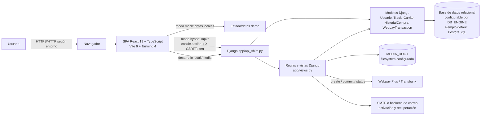

# Arquitectura del sistema — BeatsCloud

**Estado:** descripción lógica derivada del código integrado en `codex/integracion-demo-20261118`, corte 18-11-2026. No representa un despliegue productivo validado.

## Vista de componentes

## Componentes y responsabilidades

### Frontend

La SPA se encuentra en `frontend/client/` y usa React 19, TypeScript, Vite 6 y Tailwind CSS 4. `AppContext.tsx` coordina catálogo, sesión, carrito, compras, upload y playback; `django.service.ts` implementa el cliente HTTP. `VITE_API_MODE=hybrid` usa Django como fuente para operaciones integradas; `mock` mantiene datos de demostración y estado local, por lo que **no** valida backend, autorización, pago ni persistencia.

En desarrollo, `vite.config.ts` escucha en puerto 3000 y proxifica `/api` y `/media` a `127.0.0.1:8000`. Es una configuración de desarrollo; no es arquitectura productiva.

### Backend

El proyecto Django está en `beatcloud/`, con reglas/vistas HTML en `app/views.py`, API JSON propia en `app/api_shim.py`, rutas combinadas desde `app/urls.py` y modelos en `app/models.py`. Django es autoridad para sesión, roles, precio/totales del carrito, estados de transacción y permisos de archivo. La API funcional se implementa con vistas Django; no se identifica Django REST Framework como dependencia del proyecto.

### Datos y archivos

`beatcloud/settings.py` toma `DB_ENGINE`, `DB_NAME`, etc. de variables de entorno; el motor configurado por defecto y el ejemplo versionado son PostgreSQL. El corte validado usó una base PostgreSQL local aislada. Los archivos pueden residir en almacenamiento local (`MEDIA_ROOT`) o R2 cuando se configura y habilita; la integración R2 existe en código, pero no se validó contra Cloudflare en este corte. En desarrollo, Django/Vite sirven rutas de medios según configuración.

### Sesión y seguridad de solicitudes

El login de la SPA usa la sesión de Django en cookie (backend de sesión en base de datos) y un handshake CSRF mediante `GET /api/csrf/`; las operaciones mutables envían `X-CSRFToken`. `SESSION_COOKIE_HTTPONLY=True`, `SameSite=Lax` y flags Secure dependen de `DEBUG`. La API debe servirse por el mismo origen o proxy para el uso previsto de `credentials: same-origin`. No se usa JWT para esta integración.

### Pago y servicios externos

El backend integra `transbank-sdk` y mantiene `WebpayTransaction` con orden, monto, snapshot y estados `PENDING`, `AUTHORIZED`, `CANCELLED`. La aplicación debe crear, devolver al callback, confirmar con proveedor y solo entonces materializar la compra. Hay pruebas automatizadas para guards/ramas con respuestas de prueba, pero no acreditan interacción real E2E en Webpay TEST. SMTP se configura para activación de cuenta y recuperación de contraseña; servicio y cuenta activa deben verificarse en el ambiente de demo. Variables Stripe aparecen en configuración, pero no hay base suficiente para describir Stripe como flujo de pago operativo.

## Flujos principales

### Consulta y compra

1. El usuario navega la SPA; en `hybrid`, el cliente llama la API Django a través del proxy/origen configurado.
2. Django devuelve catálogo y, para áreas privadas, valida cookie de sesión y rol.
3. El servidor calcula importes del carrito; la SPA presenta el resumen recibido.
4. Django inicia Webpay y conserva estado/contexto del pedido. El navegador continúa en la pasarela externa.
5. El retorno se valida en backend (estado, usuario, monto, orden y relación con transacción). Solo la respuesta autorizada produce registro de compra.
6. La SPA actualiza el estado de pago; el comprador ve su biblioteca y solicita descarga. Django vuelve a comprobar autorización.

**Implementación:** presente en rutas/modelos/servicios. **Pruebas:** hay evidencia histórica de pruebas aisladas y simuladas. **Validación E2E real:** pendiente en el corte.

### Publicación de pista

1. Productor autenticado completa metadatos y adjunta audio/portada.
2. En `hybrid`, `AppContext.uploadTrack` forma una solicitud multipart y llama `/api/upload/`.
3. Django valida y persiste pista/archivos; la SPA actualiza la lista a partir de la respuesta.

El flujo existe en el código de la rama; una carga reciente end-to-end y sus errores requieren evidencia. En `mock`, no se crea la misma entidad persistida en backend.

### Reproducción

La API expone endpoints distintos para preview y audio completo. Django controla qué recurso autoriza; el frontend emplea el motor de audio para reproducir/visualizar. El cambio de `audioEngine.ts` incluido en PR #2 está **PENDIENTE** de prueba real en navegador.

## Estado de las integraciones

| Integración | Estado | Alcance comprobable / pendiente |
|---|---|---|
| React SPA ↔ API Django | **IMPLEMENTADO; VALIDADO parcialmente (histórico)** | Smoke/recorridos se describen en `docs/INTEGRACION_BACKEND.md`; repetir con build actual para evidencia de corte. |
| Django ↔ PostgreSQL | **IMPLEMENTADO/configurable** | Conexión real del ambiente APT no confirmada en este paquete. |
| Django ↔ almacenamiento local MEDIA_ROOT | **IMPLEMENTADO** | Persistencia compartida/durable o remota **PENDIENTE** de definición/despliegue. |
| Django ↔ Webpay Plus | **IMPLEMENTADO; algunas respuestas SIMULADAS** | Pago, retorno y descarga E2E en TEST **PENDIENTES**. |
| Django ↔ SMTP | **IMPLEMENTADO/configurable** | Activación real en la cuenta/ambiente de entrega **PENDIENTE**. |
| SPA `mock` | **SIMULADO** | Solo demostración visual; no es integración. |

## Restricciones y cuestiones de arquitectura

- No hay topología de producción, balanceador, TLS, dominio, despliegue, observabilidad o SLA validados.
- No se describe entrega de stems ni DRM.
- La cookie de sesión y CSRF requieren configuración correcta de origen/HTTPS en despliegue.
- Riesgo crítico heredado: `agregar.html` se retiró del árbol de integración tras inspeccionar solo metadatos de ZIP; contiene un miembro `.env`. No se extrajo. El blob sigue en el historial y requiere respuesta de seguridad, rotación/revocación y decisión de saneamiento histórico antes de publicar.

Para entidades, migraciones, flujos de almacenamiento privado y límites de validación, véase [Modelo de datos y almacenamiento](modelo_datos_y_almacenamiento.md) y [Registro de validación del 18-11-2026](validacion_tecnica_corte_2026-11-18.md).

## Pendiente de validación del equipo

Confirmar el motor y almacenamiento del ambiente de presentación, URL/origen y proxy usados, HTTPS/CSRF, configuración de Webpay TEST, backend SMTP, servicio de medios y entorno de despliegue. Registrar el diagrama físico solo cuando exista evidencia del despliegue.

## Fuentes

`beatcloud/settings.py`; `beatcloud/urls.py`; `app/models.py`; `app/views.py`; `app/api_shim.py`; `app/urls.py`; `frontend/client/vite.config.ts`; `frontend/client/src/context/AppContext.tsx`; `frontend/client/src/api/django.service.ts`; [Integración backend](../INTEGRACION_BACKEND.md); [Inicio del proyecto](inicio_proyecto.md).
