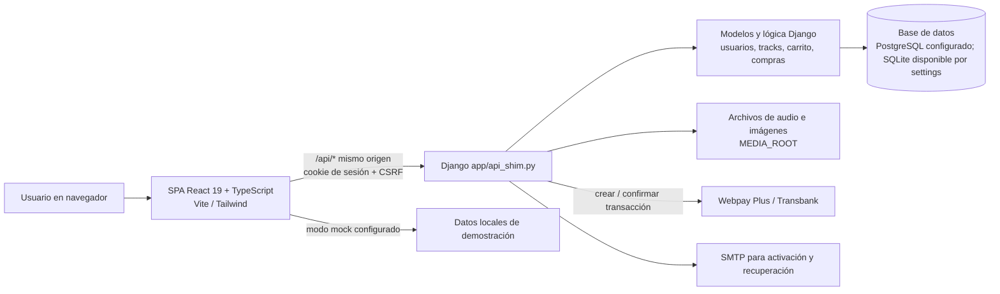

# Arquitectura de BeatsCloud

**Estado:** vista lógica derivada del código en la rama auditada, 12-11-2026. No representa topología de producción.

## Componentes

El diagrama muestra las dependencias visibles, no confirma que todos los servicios estén configurados o disponibles en el entorno de presentación.

## Recorrido principal

1. El navegador carga React; Vite proxifica `/api` al servidor Django en desarrollo local.
2. La SPA obtiene CSRF y usa sesión Django por cookie. Django autentica y valida permisos en cada endpoint.
3. Catálogo, carrito, precios y registro de compras se resuelven en el backend. La API no reemplaza esas reglas con estado local cuando `VITE_API_MODE=hybrid`.
4. Django crea la transacción Webpay, recibe el retorno y verifica el resultado antes de registrar compra. Las rutas de audio/descarga aplican autorización del backend.
5. El modo `mock` utiliza datos de demostración; no acredita persistencia, autorización ni pago real.

## Tecnologías verificadas en manifiestos/código

- Backend: Python, Django 6.0.6 según `requirements.txt`; app propia `app`, modelos Django, API JSON funcional y SDK `transbank-sdk`.
- Datos: `beatcloud/settings.py` permite configuración de motor por variables de entorno. `.env.example` usa PostgreSQL; settings conserva una alternativa local. El motor realmente usado depende del entorno.
- Frontend: React 19, TypeScript 5.7, Vite 6, Tailwind CSS 4 y `lucide-react`.
- Archivos: `FileField`/`ImageField`; previews y validación de audio usan herramientas declaradas como `mutagen`/FFmpeg según configuración.
- Sesión: cookie Django y CSRF; no JWT para autenticación SPA, según `docs/INTEGRACION_BACKEND.md` y cliente API.

## Límites/decisiones que confirmar

- Producción, hosting, proxy TLS, dominios, almacenamiento durable y monitoreo no se describen con evidencia en la configuración inspeccionada.
- Stripe aparece en variables de entorno, pero la entrega de compra documentada es Webpay; no presentar Stripe como pasarela implementada sin verificar flujo.
- No describir la protección de audio como DRM.
- La modificación local de `audioEngine.ts` requiere comprobación en navegador antes de marcar el reproductor como validado.
